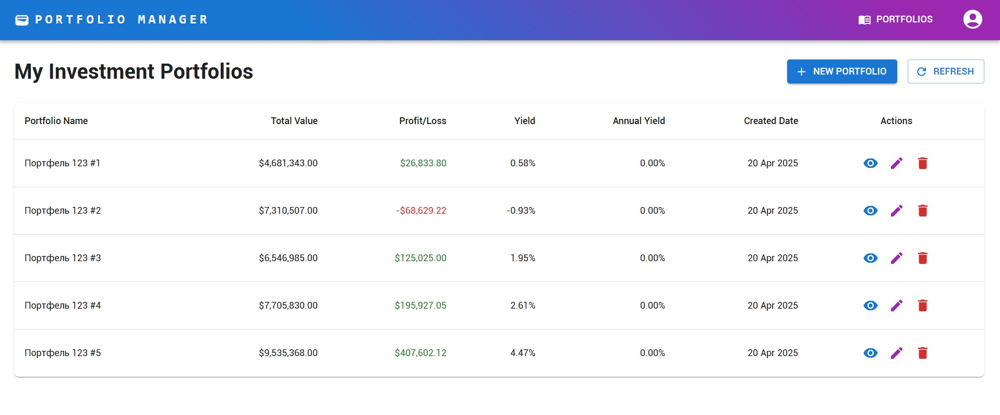
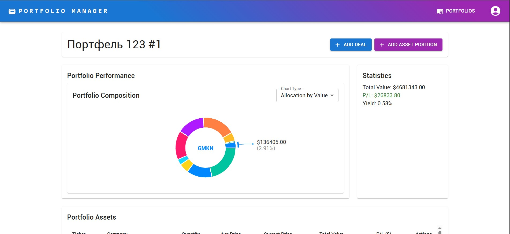
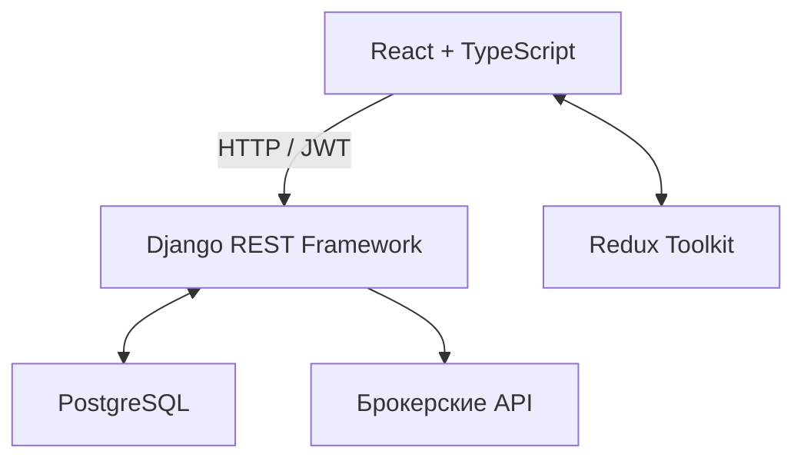

<div align="center">

# PortFel

### Инвестиционный портфель — от сделки до общей картины

Веб-приложение для учёта инвестиций, анализа доходности и работы с брокерскими портфелями.


[Возможности](#возможности) · [Интерфейс](#интерфейс) · [Архитектура](#архитектура) · [Запуск](#локальный-запуск)

</div>

## О проекте

PortFel помогает частному инвестору видеть состав вложений и финансовый результат в одном интерфейсе: вести несколько портфелей, фиксировать покупки и продажи, анализировать доходность и сравнивать вклад отдельных инструментов в прибыль или убыток.

Проект разработан в рамках выпускной квалификационной работы **«Программная подсистема для контроля инвестиционного портфеля»**. Работа охватывает проектирование модели данных и REST API, реализацию клиентской и серверной частей, интеграцию с брокерскими сервисами и визуализацию финансовых показателей.

## Возможности

| Раздел | Что можно сделать |
| --- | --- |
| **Управление портфелями** | Создавать, редактировать и удалять портфели, просматривать их состав и сводные показатели. |
| **Активы и сделки** | Вести позиции и историю покупок и продаж: инструмент, количество, цена, дата, комиссия и налог. Просматривать подробную информацию об активах. |
| **Интеграции с брокерами** | Импортировать и периодически синхронизировать портфели и сделки из Альфа-Банка и Т-Банка. |
| **Дашборды и статистика** | Отслеживать стоимость портфелей, прибыль или убыток, доходность и распределение вложений. Сравнивать финансовый результат отдельных инструментов. |
| **Технический анализ** | Анализировать эффективность сделок с помощью скользящих средних, RSI и MACD. |
| **Настройка интерфейса** | Выбирать темы оформления, менять положение и размеры окон, группировать элементы рабочего пространства. |
| **Личный кабинет** | Регистрироваться, входить в систему и работать со своими портфелями с JWT-авторизацией. |

## Интерфейс

### Обзор портфелей

Стоимость, финансовый результат и доходность собраны в одной таблице. Действия с портфелем доступны прямо из списка.



### Состав и статистика портфеля

Детальная страница объединяет диаграмму распределения активов, сводные показатели, позиции и историю сделок. Визуализация помогает оценить концентрацию вложений и вклад инструментов в общий результат.



<sub>Скриншоты из отчёта по проекту. Показан интерфейс на тестовых данных.</sub>

## Архитектура

Клиент — одностраничное приложение на React и TypeScript. Redux Toolkit управляет состоянием и асинхронной загрузкой данных; Axios связывает интерфейс с REST API. Сервер на Django обрабатывает операции с портфелями и сделками, пересчитывает показатели и обращается к внешним сервисам. Данные хранятся в PostgreSQL.



Основные сущности модели данных: пользователь, портфель, финансовый инструмент, позиция портфеля, сделка и тип актива. Позиция связывает инструмент с конкретным портфелем и хранит количество, среднюю цену и стоимость.

### Технологии

| Область | Инструменты |
| --- | --- |
| Интерфейс | React, TypeScript, React Router, Material UI, CSS |
| Состояние и HTTP | Redux Toolkit, React Redux, Axios |
| Визуализация | Recharts, Chart.js, react-chartjs-2 |
| Сервер | Python, Django, Django REST Framework, Django ORM |
| Авторизация | Djoser, Simple JWT |
| Хранение данных | PostgreSQL, psycopg2 |
| Брокерская интеграция | SDK `tinkoff-investments` |
| Инструменты разработки | Create React App / Webpack, ESLint, Git |

### Структура репозитория

| Путь | Назначение |
| --- | --- |
| [`portfel_front/src/pages`](portfel_front/src/pages) | Страницы авторизации, обзора портфелей, портфеля, актива и профиля |
| [`portfel_front/src/components`](portfel_front/src/components) | Формы, таблицы, графики и элементы интерфейса |
| [`portfel_front/src/store`](portfel_front/src/store) | Redux store и слайсы авторизации, портфелей, активов и сделок |
| [`portfel_front/src/api`](portfel_front/src/api) | HTTP-клиент и методы обращения к серверу |
| [`portfel_back/portfel`](portfel_back/portfel) | Настройки Django и маршруты API |
| [`portfel_back/portfel_online`](portfel_back/portfel_online) | Модели, сериализаторы и обработчики запросов |
| [`.env.example`](.env.example) | Шаблон локальной конфигурации без действующих секретов |

### Работа над проектом

- Проектирование пользовательских сценариев, структуры приложения, модели базы данных и взаимодействия клиента с сервером.
- Разработка React-страниц, форм и таблиц для работы с портфелями, активами и сделками; обработка состояний загрузки, ошибок и подтверждений действий.
- Организация состояния приложения через Redux Toolkit и взаимодействия с REST API через Axios.
- Реализация Django-моделей, сериализаторов и API, JWT-авторизации и брокерской интеграции.
- Разработка расчёта финансовых показателей и интерактивной визуализации данных.
- Подготовка технической документации, методики анализа портфеля и сценариев функциональной проверки.

## Локальный запуск

Для запуска кода из репозитория нужны **Node.js 20+ с npm**, **Python 3.10+** и работающий сервер **PostgreSQL**. Команды ниже приведены для Bash; в PowerShell виртуальное окружение активируется через `.venv/Scripts/Activate.ps1`.

### 1. Репозиторий и конфигурация

```bash
git clone https://github.com/BrashMack/PortFel.git
cd PortFel
cp .env.example .env
```

Создайте отдельную локальную базу PostgreSQL и пользователя с правом создавать в ней таблицы. В корневом `.env` заполните `POSTGRES_DB`, `POSTGRES_USER`, `POSTGRES_PASSWORD`, `POSTGRES_HOST` и `POSTGRES_PORT` своими параметрами.

Сгенерируйте ключ и запишите результат в `DJANGO_SECRET_KEY`:

```bash
python -c "import secrets; print(secrets.token_urlsafe(64))"
```

Для локальной отладки оставьте `DJANGO_DEBUG=True`. Django читает `.env` из корня репозитория через `python-decouple`; переменные окружения имеют приоритет. Файл `.env` исключён из Git — публикуйте только шаблон с демонстрационными значениями.

### 2. Сервер

Из корня репозитория:

```bash
python -m venv .venv
source .venv/bin/activate
python -m pip install -r portfel_back/requirements.txt
cd portfel_back
python manage.py makemigrations portfel_online
python manage.py migrate
python manage.py check
python manage.py runserver
```

Миграции приложения создаются локально: каталог `migrations/` исключён из Git. API доступен по адресу **http://localhost:8000/**.

### 3. Клиент

В отдельном терминале из корня репозитория:

```bash
cd portfel_front
npm ci
npm start
```

Откройте **http://localhost:3000/** и зарегистрируйте пользователя. Адрес API задан в [`portfel_front/src/config.ts`](portfel_front/src/config.ts); при смене адреса сервера измените его и разрешённые CORS origins в настройках Django.

### Тестовые данные

Новая база будет пустой. Для знакомства с интерфейсом можно использовать `fill_data.py` из каталога `portfel_back`: он создаёт тестового пользователя, справочники, портфели и сделки. **Запускайте его только на отдельной тестовой базе: скрипт предварительно удаляет данные моделей проекта.** Учётные данные тестового пользователя задаются в функции `get_or_create_user()` этого скрипта.

Для ручного учёта и тестовых данных брокерский токен не нужен. Для получения данных Т-Инвестиций используется собственный токен с правами только на чтение, который вводится в форму **Import from Tinkoff Investments** на странице портфеля.

### Команды фронтенда

| Команда | Назначение |
| --- | --- |
| `npm start` | Локальный сервер разработки |
| `npm run build` | Сборка в каталог `portfel_front/build` |
| `npm test` | Запуск Jest через `react-scripts` |

### Секреты и окружение

Пароли и ключи храните в локальном `.env`. Если секрет ранее был опубликован и использовался в работающем сервисе, замените его: удаление файла из текущей версии не удаляет значения из истории Git.

---

**Автор:** [Георгий / BrashMack](https://github.com/BrashMack) · Выпускной проект
